# 框一下 Region Snap

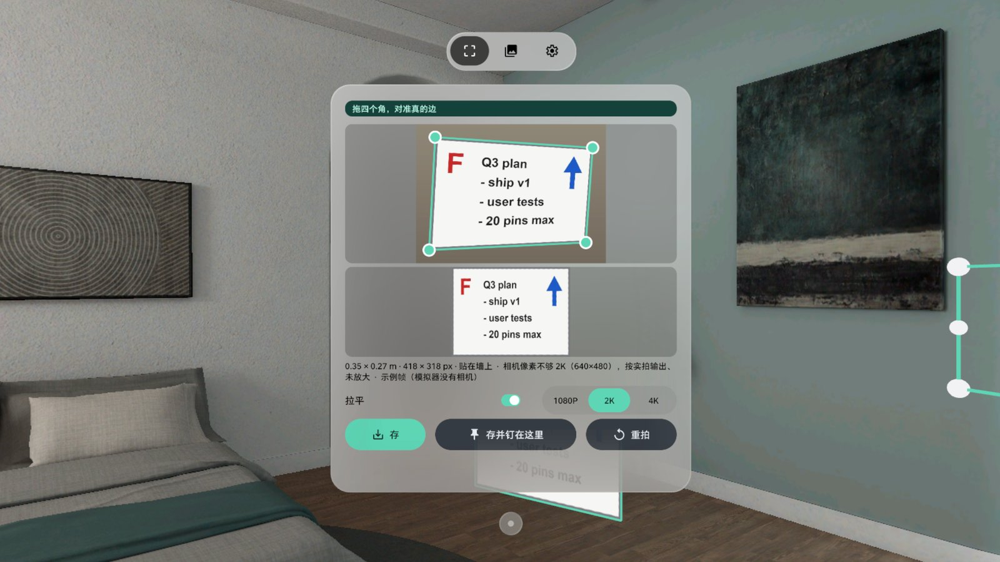

**中文** · [English](#english)

在真实房间里画一个框，只拍框住的那一块：桌上的文件、墙上的白板、书页、窗外。拍完自动拉平成正面图，存进相册，还能把它钉回原来的位置当便签。PICO Spatial SDK 应用（Full Space，透视 MR），v0.1.5。

## 能做什么

- **画框即拍**：手柄射线按住扳机拖一个框，或眼睛看一个点、捏住拉出框（画一圈也行），再按一下 / 捏一下就拍
- **框默认正对你**：新框竖直、正对眼睛；贴在墙上 / 桌上时沿视线落回表面
- **绕竖直轴转 + 回正**：握把 + 摇杆左右转，或点 [左转 15°] [右转 15°] [回正]
- **拉平**：四个角对准真实的边，按 4 点透视拉成正面图，保持真实比例
- **1080P / 2K / 4K 输出**：设置和预览页都能选（默认 2K，记住选择）；相机像素不够时如实按实拍输出，不放大
- **手柄 + 眼手两套输入**：瞄准只认手柄射线和眼动 + 捏合，不用头部朝向
- **存并钉在这里**：存进相册 `Pictures/RegionSnap`，也能钉回原处当便签；「已截」页管理全部截图和便签
- 中英双语；全部本机运行，不联网、不上传、不需要账号

## 截图

截图来自 PICO 模拟器（模拟器没有透视相机，拍到的是内置示例帧）。

| | |
|---|---|
|  拉平预览：四个角对准白板的边，下方是拉平结果，可选 1080P / 2K / 4K | 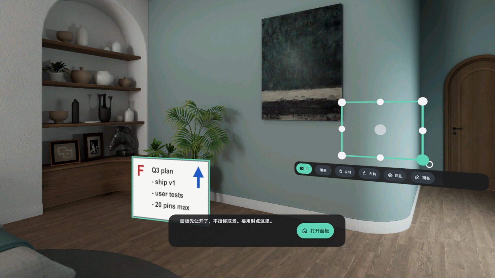 在墙上画好的框和快门条：拍 / 重画 / 左转 / 右转 / 回正 / 面板 |
| 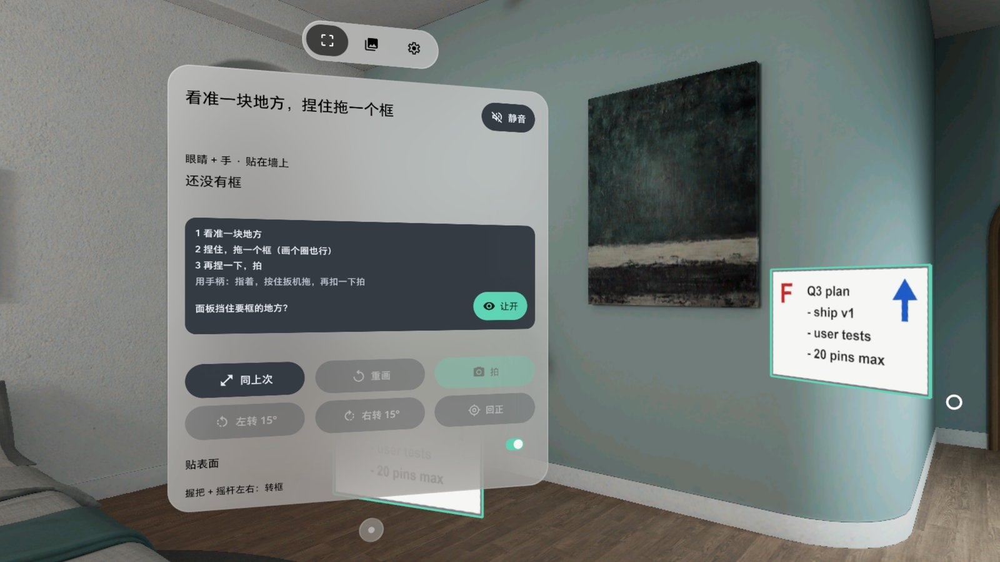 存并钉在这里：拉平的便签钉在墙上原处 | 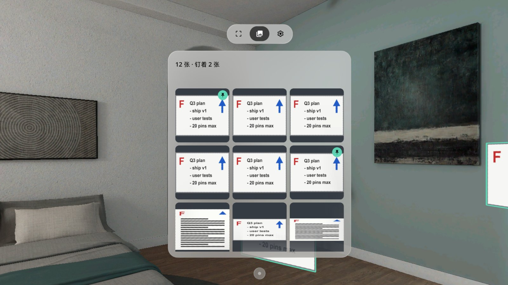 已截：全部截图，带图钉的是钉在房间里的 |
| 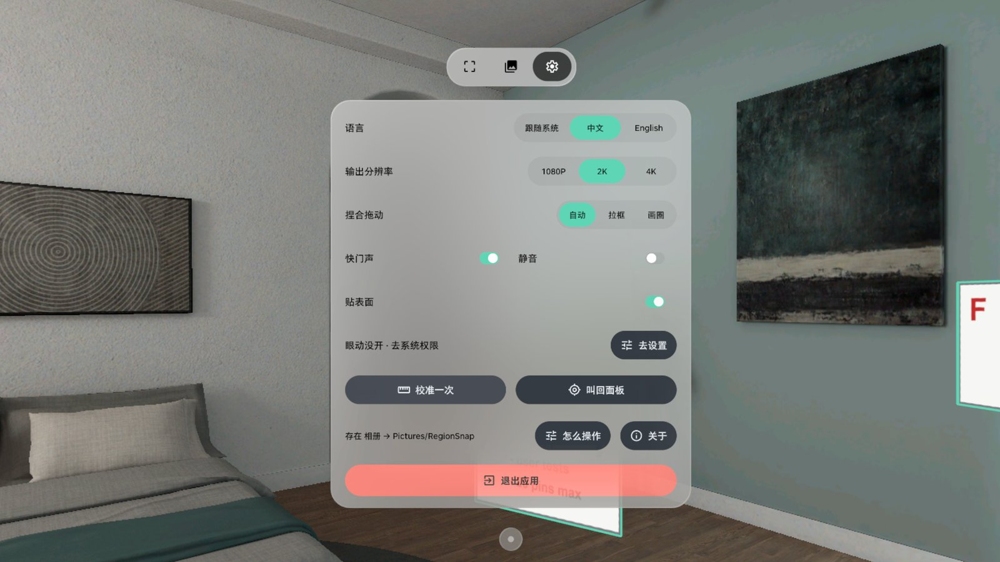 设置：输出分辨率 1080P / 2K / 4K、捏合拖动方式、贴表面 | 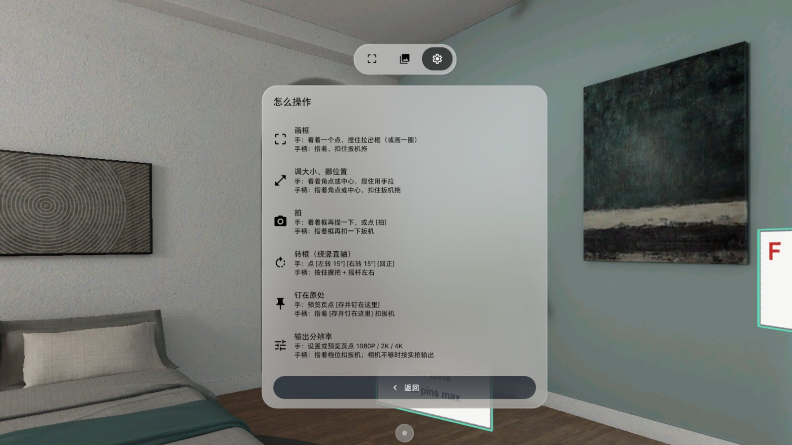 怎么操作：每一步都写了手和手柄两种做法 |

## 安装

从 [Release v0.1.5](https://github.com/kejing-dev/RegionSnap/releases/tag/v0.1.5) 下载 `RegionSnap-v0.1.5.apk`（assembleRelease 未签名包，供 Vibe Lab 托管签名）。自己装到头显需要先签名，或用源码 `./gradlew assembleDebug` 出调试包：

```
adb install -r RegionSnap-v0.1.5.apk
pico-cli app launch io.embodit.regionsnap
```

需要 PICO OS 6（Spatial SDK 6.1.9，minSdk 35）；权限：相机（只在按下拍的那一刻读一帧）、眼动、手部追踪、空间数据。

## 演示视频

Release 里的 `video-01.mp4` 是模拟器逐帧截图拼成的演示，由调试广播驱动，**非真实手势录像**。

---

## English

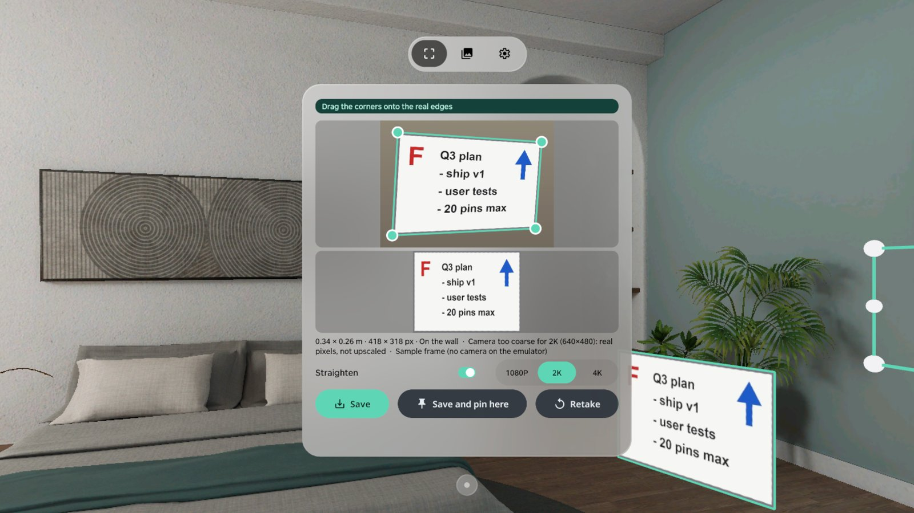

Draw a frame in your real room and shoot only what's inside it: the paper on the desk, the whiteboard, a page, the view out the window. It flattens the shot head-on, saves it to your photos, and can pin it back where it came from. PICO Spatial SDK app (Full Space, passthrough MR), v0.1.5.

### Features

- **Frame and shoot**: hold the controller trigger and drag a frame, or look at a spot and pinch-drag (a loop works too); press or pinch again to shoot
- **Frames face you**: new frames stand upright and face your eyes; on a wall or table they land back on the surface along your line of sight
- **Turn about the vertical axis, then face me**: grip + stick left / right, or tap [Left 15°] [Right 15°] [Face me]
- **Straighten**: drag the four corners onto the real edges for a 4-point perspective fix at the true aspect ratio
- **1080P / 2K / 4K output**: pick it in Settings or on the preview (2K by default, remembered); when the camera has fewer pixels it saves the real size, never upscaled
- **Controller and eyes + hand**: aiming uses the controller ray or gaze + pinch only, never head direction
- **Save and pin here**: saves to `Pictures/RegionSnap` and can pin the picture back in place as a note; the Shots page manages shots and notes
- Chinese and English; runs fully on device, no network, no upload, no account

### Screenshots

From the PICO emulator (it has no passthrough camera, so shots use a built-in sample frame).

| | |
|---|---|
|  Straighten preview with the 1080P / 2K / 4K choice | 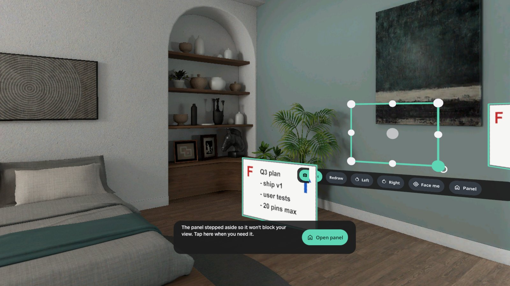 A frame on the wall and its shutter bar |
| 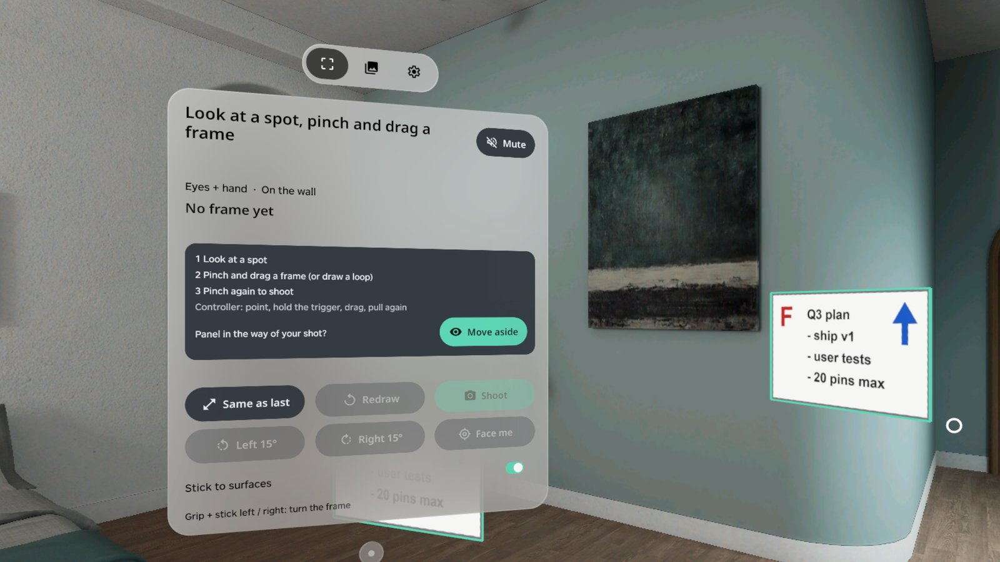 Save and pin here: the flattened note on the wall | 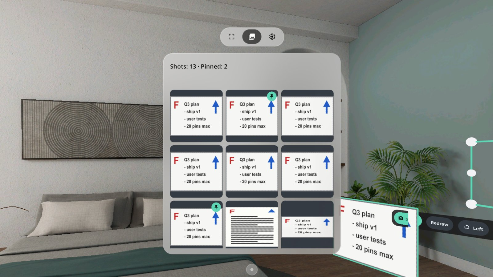 Shots: every picture, pinned ones marked |
| 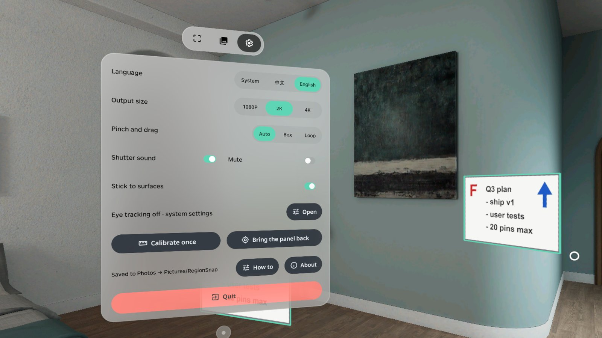 Settings: output size, pinch-drag mode, stick to surfaces | 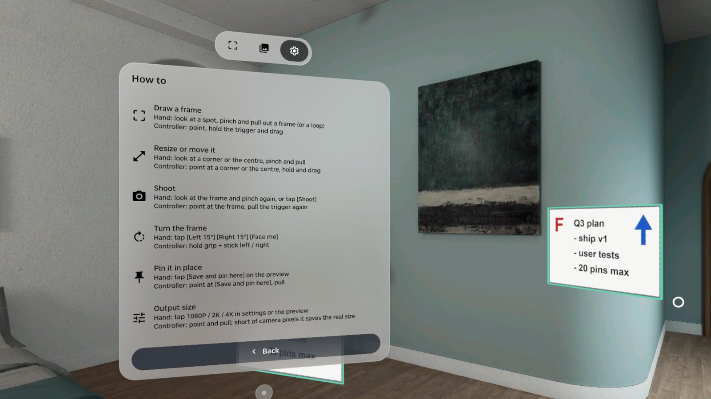 How to: hand and controller steps for each action |

### Install

Download `RegionSnap-v0.1.5.apk` from [Release v0.1.5](https://github.com/kejing-dev/RegionSnap/releases/tag/v0.1.5) (unsigned assembleRelease build for Vibe Lab's hosted signing). Sign it before sideloading, or build a debug APK with `./gradlew assembleDebug`:

```
adb install -r RegionSnap-v0.1.5.apk
pico-cli app launch io.embodit.regionsnap
```

Requires PICO OS 6 (Spatial SDK 6.1.9, minSdk 35). Permissions: camera (one frame read only when you shoot), eye tracking, hand tracking, spatial data.

### Demo video

`video-01.mp4` on the Release is stitched from emulator frames and driven by debug broadcasts. **It is not a recording of real gestures.**

Developer notes: [AGENTS.md](AGENTS.md).
